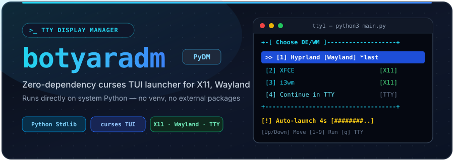

<p align="center">
  
</p>

<p align="center">
  <strong>🇬🇧 English</strong> | <a href="README.ru.md">🇷🇺 Русский</a>
</p>

---

# 🖥️ botyaradm (PyDM)

**botyaradm** (also referred to as **PyDM**) is a lightweight, fast, and cozy **TTY display manager / session launcher** for Linux written in pure Python using the built-in `curses` library.

It runs directly on **system Python** with **zero third-party dependencies** — no `venv`, no `pip install`, and nothing to break when Python or system packages upgrade! 🚀

---

## ✨ Features

- 🧱 **Zero External Dependencies** — built purely on the Python standard library (`curses`, `json`, `pathlib`, `configparser`, `shutil`).
- 🎨 **Clean ASCII `curses` TUI & 25 Color Themes** — renders crisp ASCII box borders, logo, session type badges (`[X11]`, `[Wayland]`, `[TTY]`), live clock, and adaptive layout for both large terminals and classic 80×24 Linux TTYs. Includes 25 built-in themes (**Ayu Dark/Mirage/Light**, **Gruvbox Dark/Material/Light**, **Pacman (Arch Linux)**, **Catppuccin**, **Dracula**, **Nord**, **Tokyo Night**, **One Dark**, **Monokai Pro**, **Solarized**, **Everforest**, **Kanagawa**, **Rosé Pine**, **Synthwave '84**, **Cyberpunk**, **Matrix**, **Oxocarbon**, **Amber CRT**, **Monochrome**) with 256-color and 8-color TTY fallback!
- 🧙 **Interactive First-Run Setup Wizard** — automatically launches on first run (or anytime via `w` / `--setup`):
  - **User selection mode**: if multiple human users exist, choose whether to always ask on login or pick a default user (with 1 user, it is selected automatically).
  - **Password prompt**: optionally require system password verification (via PAM / `su`) before showing the session menu.
  - **Live theme preview**: browse all 25 themes with instant live recoloring.
- 🧹 **Clean Terminal Before & After** — clears the terminal before starting the TUI and cleanly clears it upon exiting or launching a session.
- 🔍 **Automatic DE/WM Detection** — scans `/usr/share/xsessions/*.desktop`, `/usr/share/wayland-sessions/*.desktop`, and falls back to 35+ known DE/WM binaries in `PATH` (`KNOWN_SESSIONS`).
- ⚡ **Smart History & Sorting** — atomically tracks launch counts and timestamps in `~/.config/pydm/history.json`, placing your most recently and frequently used sessions at the top.
- ⏱️ **Live Auto-Launch Countdown** — automatically starts your last used DE/WM after a configurable timeout (default `5` seconds) with a real-time ASCII progress bar (`[########..]`); press any key to cancel.
- 💬 **100+ Time-of-Day Greetings** — displays non-repeating Russian greetings tailored to night, early morning, morning, day, evening, and late evening.
- 🚀 **X11, Wayland & TTY Support**:
  - **X11**: generates `~/.xinitrc.pydm` (loading `~/.Xresources` and `~/.xprofile` without touching your `~/.xinitrc`) and replaces the process via `startx`.
  - **Wayland**: exports `XDG_SESSION_TYPE=wayland` and executes the compositor directly.
  - **TTY**: drops cleanly back into your shell anytime.
- 🛡️ **Built-in Bash Emergency Fallback** — includes [`fallback.sh`](fallback.sh) with zero Python dependencies in case Python fails to start.

---

## 📁 Project Structure

```text
botyaradm/
├── assets/
│   ├── banner-en.svg    # 🎨 English README banner
│   └── banner-ru.svg    # 🎨 Russian README banner
├── main.py              # 🚪 Entry point, terminal clear & flow orchestration
├── menu.py              # 🖥️ Interactive curses TUI (sessions, user picker, password)
├── setup_wizard.py      # 🧙 First-run setup wizard with live theme preview
├── themes.py            # 🎨 25 color themes (256-color + 8-color TTY fallback)
├── auth.py              # 🔐 System user detection & PAM/su password check
├── settings.py          # 💾 Persistent settings (~/.config/pydm/settings.json)
├── tui_utils.py         # 🧹 Terminal clearing & shared curses helpers
├── detector.py          # 🔍 .desktop scanner & X11/Wayland/PATH detection
├── history.py           # 📊 Atomic launch history & session sorting
├── launcher.py          # 🚀 Session launcher (startx / Wayland / TTY)
├── greetings.py         # 💬 100+ time-of-day greetings
├── config.py            # ⚙️ User, timeout, paths, and curses UI settings
├── fallback.sh          # 🛟 Emergency bash menu if Python fails
└── LICENSE              # 📄 MIT License
```

---

## 📦 Requirements

- 🐍 **Python 3.10+** (standard library with `curses`, included by default on Linux distributions)
- 🖼️ **For X11 sessions**: `startx` (`xorg-xinit`)
- 🪟 **For Wayland sessions**: your Wayland compositor (e.g. `hyprland`, `sway`, `river`, `labwc`, `wayfire`)

---

## 🛠️ Installation & Auto-Start

Clone the repository into `~/.config/pydm`:

```bash
git clone https://github.com/dimasbotyara/botyaradm.git ~/.config/pydm
chmod +x ~/.config/pydm/fallback.sh
```

Edit `~/.config/pydm/config.py` to set your `USERNAME`, `AUTO_SELECT_TIMEOUT`, and UI preferences.

### 🐟 Auto-start in Fish (`~/.config/fish/config.fish`)

Run on `tty1` login (with automatic fallback to `fallback.sh` if Python exits with an error):

```fish
if status is-login
    if test (tty) = "/dev/tty1"; and not set -q DISPLAY; and not set -q WAYLAND_DISPLAY
        python3 ~/.config/pydm/main.py
        if test $status -ne 0
            bash ~/.config/pydm/fallback.sh
        end
    end
end
```

### 🐚 Auto-start in Bash / Zsh (`~/.bash_profile` or `~/.zprofile`)

```bash
if [ "$(tty)" = "/dev/tty1" ] && [ -z "$DISPLAY" ] && [ -z "$WAYLAND_DISPLAY" ]; then
    python3 "$HOME/.config/pydm/main.py" || bash "$HOME/.config/pydm/fallback.sh"
fi
```

---

## ⌨️ Controls

| Key | Action |
| --- | --- |
| `↑` / `↓` or `k` / `j` | Move selection up / down (with wrap-around) |
| `1` – `9`, `0` | Quick-launch items 1–10 immediately |
| `Home` / `End` or `g` / `G` | Jump to first / last item |
| `PgUp` / `PgDn` | Scroll page up / down |
| `Enter` | Launch selected DE/WM |
| `w` | Re-open Setup Wizard (user, password, theme) |
| `Any key` (during timer) | Cancel auto-launch countdown |
| `q` / `Esc` / `Ctrl+C` | Exit cleanly into TTY |

---

## ⚙️ Configuration (`config.py`)

Key options in [`config.py`](config.py):

- `USERNAME` — name used in greetings and the status bar.
- `AUTO_SELECT_TIMEOUT` — seconds before auto-launching the last used session (`0` disables auto-launch).
- `SHOW_ASCII_LOGO` — toggle the ASCII header banner in the TUI.
- `SHOW_SESSION_TYPE` — show `[X11]`, `[Wayland]`, and `[TTY]` tags.
- `SHOW_STATUS_BAR` — show clock, username, and detected session count.
- `COLOR_GREETING`, `COLOR_SELECTED`, `COLOR_UNSELECTED`, `COLOR_COUNTDOWN`, `COLOR_TTY_OPTION`, `COLOR_ACCENT` — curses color names (`black`, `red`, `green`, `yellow`, `blue`, `magenta`, `cyan`, `white`).
- `KNOWN_SESSIONS` — fallback command-to-name dictionary for DEs/WMs without `.desktop` files.
- `CLEAR_TERMINAL` — clear the terminal before startup and after exit (`True` / `False`).
- `DEFAULT_THEME` — default theme ID before running the Setup Wizard.

---

## 🤝 Contributing & How to Open a PR

Contributions, new color themes, DE/WM entries, and bug fixes are always welcome! 🙌

### 1️⃣ Fork & Create a Branch

```bash
# Fork the repo on GitHub, then clone your fork:
git clone https://github.com/<your-username>/botyaradm.git
cd botyaradm

# Create a new branch for your changes:
git checkout -b feat/my-awesome-feature
```

### 2️⃣ Make Your Changes

- 🎨 **Add a new theme**: add a `Theme(...)` entry to `_THEMES_LIST` in [`themes.py`](themes.py) with both `palette_256` and `palette_8` fallback colors.
- 🖥️ **Add a DE/WM**: add its launch command and display name to `KNOWN_SESSIONS` in [`config.py`](config.py) (and optionally to [`fallback.sh`](fallback.sh)).
- 💬 **Add greetings**: extend `_GREETINGS` in [`greetings.py`](greetings.py).
- 🧱 **Keep zero dependencies**: please stick to the Python standard library only (`curses`, `json`, `pathlib`, etc.) so `botyaradm` always works on system Python!

### 3️⃣ Test Locally

```bash
# Compile-check all Python files:
python3 -m py_compile *.py

# Launch in a terminal (or test with a clean HOME):
HOME=$(mktemp -d) python3 main.py
```

### 4️⃣ Commit, Push & Open a Pull Request

```bash
git add -A
git commit -m "feat: add my awesome theme"
git push -u origin feat/my-awesome-feature
```

Then open a **Pull Request** against `dimasbotyara/botyaradm` (`main`) on GitHub — or via GitHub CLI:

```bash
gh pr create --base main --title "feat: add my awesome theme" --body "Description of changes"
```

---

## 📄 License

Licensed under the [MIT License](LICENSE).
