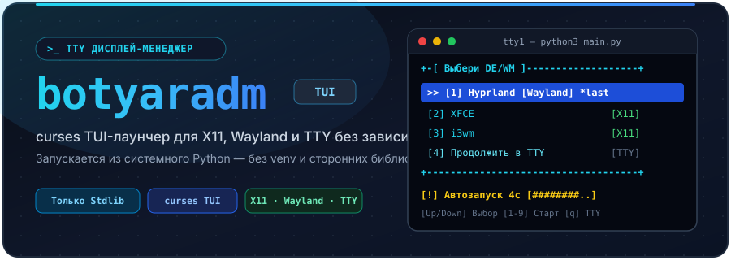

<p align="center">
  
</p>

<p align="center">
  <a href="README.md">🇬🇧 English</a> | <strong>🇷🇺 Русский</strong>
</p>

---

# 🖥️ botyaradm (PyDM)

**botyaradm** (внутри проекта также **PyDM**) — лёгкий, быстрый и уютный **TTY дисплей-менеджер / лаунчер сессий** для Linux на чистом Python с использованием встроенной библиотеки `curses`.

Работает напрямую на **системном Python** и не требует **ни одной внешней зависимости** — никаких `venv`, `pip install` и поломок при обновлении Python или системы! 🚀

---

## ✨ Возможности

- 🧱 **Ноль сторонних зависимостей** — только стандартная библиотека Python (`curses`, `json`, `pathlib`, `configparser`, `shutil`).
- 🎨 **Стильный ASCII TUI на `curses` и 25 тем оформления** — аккуратные ASCII-рамки, логотип, теги типа сессии (`[X11]`, `[Wayland]`, `[TTY]`), часы и адаптивная вёрстка для больших терминалов и классического Linux TTY 80×24. Встроены 25 тем (**Ayu Dark/Mirage/Light**, **Gruvbox Dark/Material/Light**, **Pacman (Arch Linux)**, **Catppuccin**, **Dracula**, **Nord**, **Tokyo Night**, **One Dark**, **Monokai Pro**, **Solarized**, **Everforest**, **Kanagawa**, **Rosé Pine**, **Synthwave '84**, **Cyberpunk**, **Matrix**, **Oxocarbon**, **Amber CRT**, **Monochrome**) с поддержкой 256 цветов и fallback на 8 цветов!
- 🧙 **Мастер настройки при первом запуске (Setup Wizard)** — открывается автоматически при старте (или по клавише `w` / флагу `--setup`):
  - **Выбор пользователя**: если в системе больше одного пользователя, спрашивает, выбирать ли его при каждом входе или использовать одного по умолчанию (если пользователь один — выбирается автоматически).
  - **Запрос пароля**: по желанию проверяет системный пароль (через PAM / `su`) перед запуском меню.
  - **Живой предпросмотр тем**: переключение всех 25 тем в реальном времени прямо при прокрутке.
- 🧹 **Очистка терминала до и после работы** — очищает экран перед запуском TUI и после выхода или старта сессии.
- 🔍 **Автопоиск DE/WM** — сканирует `/usr/share/xsessions/*.desktop`, `/usr/share/wayland-sessions/*.desktop`, а также проверяет 35+ известных команд из `KNOWN_SESSIONS` в `PATH`.
- ⚡ **Умная история и сортировка** — атомарно сохраняет счётчик запусков и время последнего использования в `~/.config/pydm/history.json`, поднимая частые и недавние сессии наверх списка.
- ⏱️ **Живой таймер автозапуска** — автоматически запускает последнюю использованную DE/WM после настраиваемой паузы (по умолчанию `5` секунд) с ASCII-прогресс-баром (`[########..]`); отменяется любой клавишей.
- 💬 **100+ приветствий по времени суток** — неповторяющиеся случайные фразы для ночи, раннего утра, утра, дня, вечера и позднего вечера.
- 🚀 **Поддержка X11, Wayland и TTY**:
  - **X11**: создаёт `~/.xinitrc.pydm` (подгружая `~/.Xresources` и `~/.xprofile`, не трогая ваш `~/.xinitrc`) и передаёт управление через `startx`.
  - **Wayland**: выставляет `XDG_SESSION_TYPE=wayland` и запускает композитор напрямую.
  - **TTY**: аккуратно возвращает управление в shell.
- 🛡️ **Аварийный Bash-режим** — в комплекте есть [`fallback.sh`](fallback.sh) без зависимости от Python на случай сбоя.

---

## 📁 Структура проекта

```text
botyaradm/
├── assets/
│   ├── banner-en.svg    # 🎨 Английский баннер для README
│   └── banner-ru.svg    # 🎨 Русский баннер для README
├── main.py              # 🚪 Точка входа, очистка терминала и общий сценарий
├── menu.py              # 🖥️ Интерактивный curses TUI (сессии, выбор юзера, пароль)
├── setup_wizard.py      # 🧙 Мастер настройки с живым предпросмотром тем
├── themes.py            # 🎨 25 цветовых тем (256 цветов + 8-цветный TTY fallback)
├── auth.py              # 🔐 Поиск пользователей системы и проверка пароля (PAM/su)
├── settings.py          # 💾 Сохранение настроек (~/.config/pydm/settings.json)
├── tui_utils.py         # 🧹 Очистка терминала и общие утилиты curses
├── detector.py          # 🔍 Поиск .desktop файлов и бинарников в PATH
├── history.py           # 📊 Атомарная история запусков и сортировка
├── launcher.py          # 🚀 Запуск сессий (startx / Wayland / TTY)
├── greetings.py         # 💬 100+ приветствий по времени суток
├── config.py            # ⚙️ Настройки пользователя, таймаута, путей и TUI
├── fallback.sh          # 🛟 Аварийное bash-меню при ошибке Python
└── LICENSE              # 📄 Лицензия MIT
```

---

## 📦 Требования

- 🐍 **Python 3.10+** (стандартная библиотека с модулем `curses`)
- 🖼️ **Для X11-сессий**: `startx` (`xorg-xinit`)
- 🪟 **Для Wayland-сессий**: установленный Wayland-композитор (например, `hyprland`, `sway`, `river`, `labwc`, `wayfire`)

---

## 🛠️ Установка и автозапуск

Склонируйте репозиторий в `~/.config/pydm`:

```bash
git clone https://github.com/dimasbotyara/botyaradm.git ~/.config/pydm
chmod +x ~/.config/pydm/fallback.sh
```

При необходимости отредактируйте `~/.config/pydm/config.py` (имя пользователя `USERNAME`, таймаут `AUTO_SELECT_TIMEOUT`, цвета и опции интерфейса).

### 🐟 Автозапуск в Fish (`~/.config/fish/config.fish`)

Запуск при входе в `tty1` (с автоматическим переходом в `fallback.sh`, если Python завершился с ошибкой):

```fish
if status is-login
    if test (tty) = "/dev/tty1"; and not set -q DISPLAY; and not set -q WAYLAND_DISPLAY
        python3 ~/.config/pydm/main.py
        if test $status -ne 0
            bash ~/.config/pydm/fallback.sh
        end
    end
end
```

### 🐚 Автозапуск в Bash / Zsh (`~/.bash_profile` или `~/.zprofile`)

```bash
if [ "$(tty)" = "/dev/tty1" ] && [ -z "$DISPLAY" ] && [ -z "$WAYLAND_DISPLAY" ]; then
    python3 "$HOME/.config/pydm/main.py" || bash "$HOME/.config/pydm/fallback.sh"
fi
```

---

## ⌨️ Управление

| Клавиша | Действие |
| --- | --- |
| `↑` / `↓` или `k` / `j` | Перемещение по списку (с зацикливанием) |
| `1` – `9`, `0` | Быстрый запуск пунктов 1–10 |
| `Home` / `End` или `g` / `G` | Переход в начало / конец списка |
| `PgUp` / `PgDn` | Пролистывание на страницу вверх / вниз |
| `Enter` | Запустить выбранную DE/WM |
| `w` | Повторно открыть мастер настройки (юзер, пароль, тема) |
| `Любая клавиша` (при таймере) | Отменить автозапуск |
| `q` / `Esc` / `Ctrl+C` | Выйти в TTY |

---

## ⚙️ Конфигурация (`config.py`)

Основные параметры в [`config.py`](config.py):

- `USERNAME` — имя пользователя для приветствий и строки статуса.
- `AUTO_SELECT_TIMEOUT` — задержка в секундах перед автозапуском последней сессии (`0` отключает автозапуск).
- `SHOW_ASCII_LOGO` — показывать или скрывать ASCII-логотип в шапке.
- `SHOW_SESSION_TYPE` — отображать бейджи `[X11]`, `[Wayland]`, `[TTY]`.
- `SHOW_STATUS_BAR` — отображать строку с временем, пользователем и числом сессий.
- `COLOR_GREETING`, `COLOR_SELECTED`, `COLOR_UNSELECTED`, `COLOR_COUNTDOWN`, `COLOR_TTY_OPTION`, `COLOR_ACCENT` — имена цветов `curses` (`black`, `red`, `green`, `yellow`, `blue`, `magenta`, `cyan`, `white`).
- `KNOWN_SESSIONS` — словарь резервных команд DE/WM на случай отсутствия `.desktop` файлов.
- `CLEAR_TERMINAL` — очистка терминала до запуска и после выхода (`True` / `False`).
- `DEFAULT_THEME` — тема по умолчанию до прохождения мастера настройки.

---

## 🤝 Как внести вклад и создать PR

Мы всегда рады новым темам оформления, поддержке DE/WM и улучшениям! 🙌

### 1️⃣ Сделайте форк и создайте ветку

```bash
# Сделайте Fork репозитория на GitHub и клонируйте свой форк:
git clone https://github.com/<your-username>/botyaradm.git
cd botyaradm

# Создайте отдельную ветку под изменения:
git checkout -b feat/my-awesome-feature
```

### 2️⃣ Внесите изменения

- 🎨 **Добавить новую тему**: добавьте объект `Theme(...)` в список `_THEMES_LIST` в [`themes.py`](themes.py) с палитрой `palette_256` и fallback-цветами `palette_8`.
- 🖥️ **Добавить DE/WM**: добавьте команду запуска и название в `KNOWN_SESSIONS` в [`config.py`](config.py) (и при желании в [`fallback.sh`](fallback.sh)).
- 💬 **Добавить приветствия**: дополните словарь `_GREETINGS` в [`greetings.py`](greetings.py).
- 🧱 **Без сторонних зависимостей**: используйте только стандартную библиотеку Python (`curses`, `json`, `pathlib` и т.д.), чтобы проект стабильно запускался из системного Python.

### 3️⃣ Проверьте изменения локально

```bash
# Проверка синтаксиса всех Python-файлов:
python3 -m py_compile *.py

# Безопасный тест с чистым временным HOME:
HOME=$(mktemp -d) python3 main.py
```

### 4️⃣ Закоммитьте, отправьте и откройте Pull Request

```bash
git add -A
git commit -m "feat: add my awesome theme"
git push -u origin feat/my-awesome-feature
```

После этого откройте **Pull Request** в ветку `main` репозитория `dimasbotyara/botyaradm` на GitHub — или одной командой через GitHub CLI:

```bash
gh pr create --base main --title "feat: add my awesome theme" --body "Описание изменений"
```

---

## 📄 Лицензия

Проект распространяется под лицензией [MIT](LICENSE).
